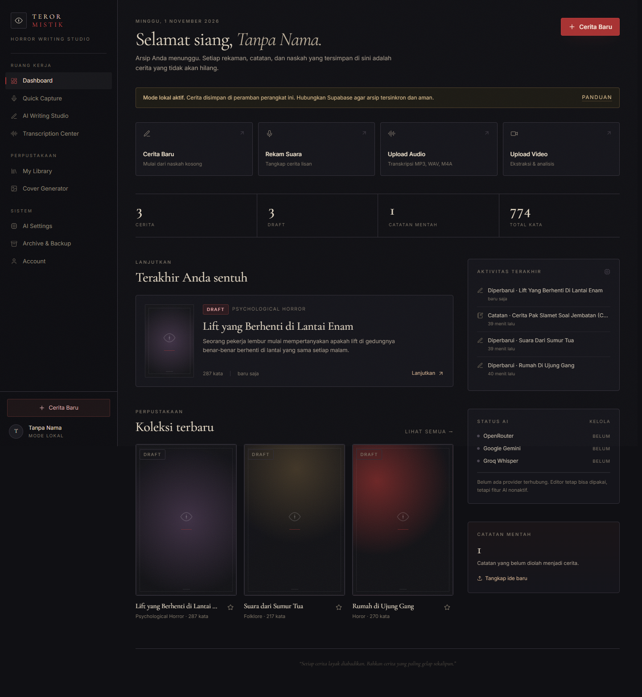
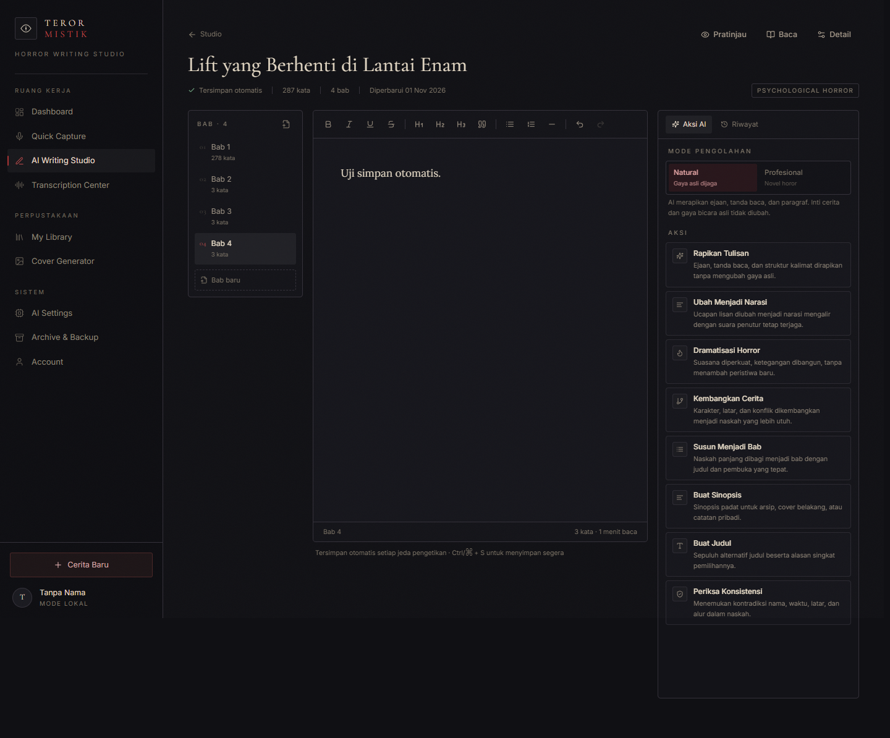
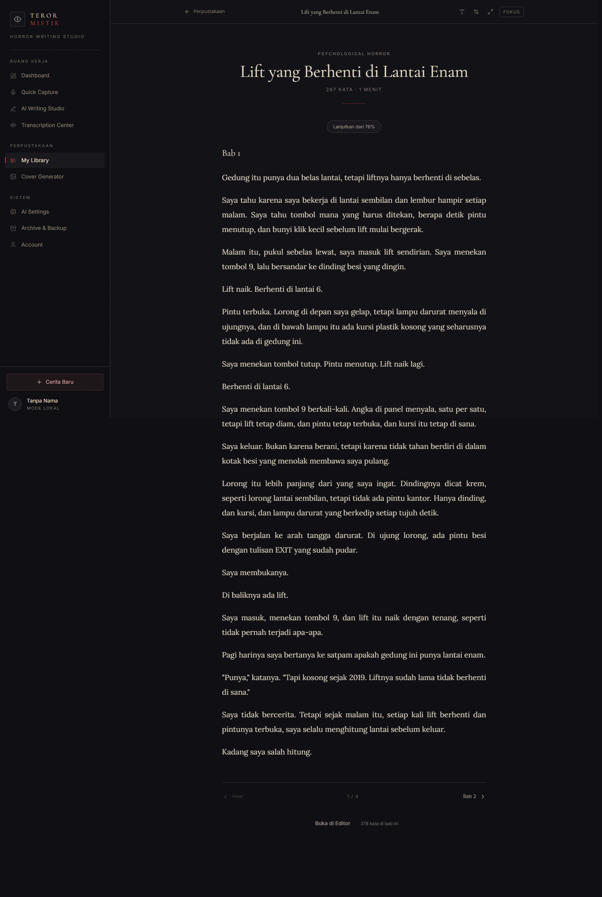
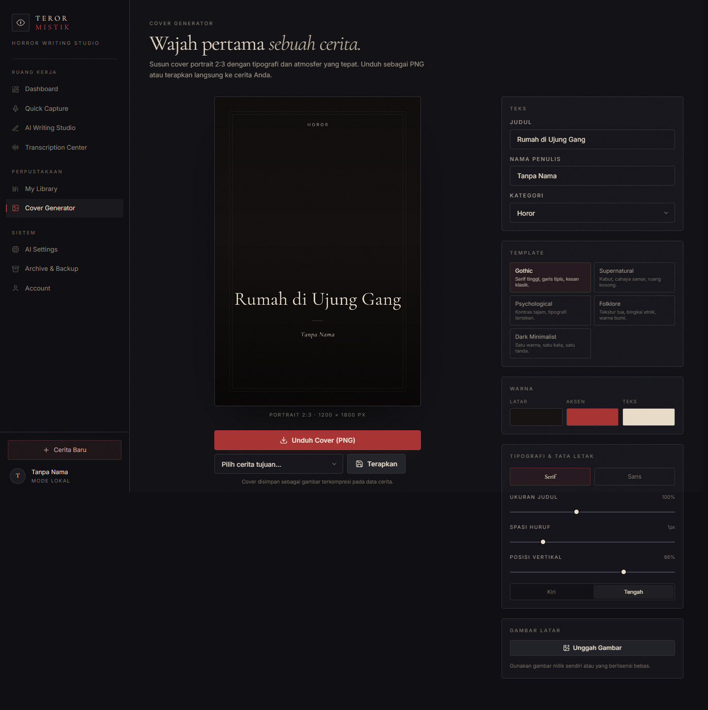
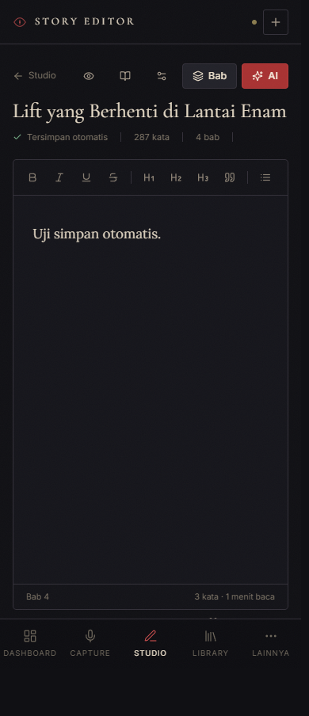

# TEROR MISTIK

**Personal AI Horror Writing Studio** — arsip cerita, asisten penulisan AI, dan perpustakaan digital pribadi.

> *Setiap cerita layak diabadikan. Bahkan cerita yang paling gelap sekalipun.*

---

## Apa ini

TEROR MISTIK adalah aplikasi web pribadi untuk mendokumentasikan cerita horor yang selama ini
disampaikan secara lisan — kepada murid, teman, atau siapa pun. Aplikasi ini menggabungkan:

- **Arsip cerita** dengan bab, versi, cover, dan status penulisan.
- **Asisten penulisan AI** dua mode: *Natural Storytelling* dan *Professional Horror Novel*.
- **Voice-to-text** langsung di peramban (Web Speech API).
- **Transkripsi audio & video** melalui Groq Whisper dan Google Gemini.
- **Editor profesional** berbasis TipTap dengan penyimpanan otomatis.
- **Perpustakaan digital** dengan pencarian, filter, favorit, dan mode baca.
- **Cover generator** portrait 2:3 dengan lima template.
- **Backup & ekspor** ke TXT, Markdown, HTML, DOCX, dan JSON.

Seluruh antarmuka berbahasa Indonesia. Tidak ada registrasi publik. Tidak ada halaman yang dapat
diakses tanpa sesi pemilik.

---

## Tampilan

| Dashboard | Story Editor |
| --- | --- |
|  |  |

| Reading Mode | Cover Generator |
| --- | --- |
|  |  |



---

## Menjalankan dalam 2 menit

```bash
npm install
npm run dev
```

Buka <http://localhost:3000>.

Tanpa konfigurasi apa pun, aplikasi berjalan dalam **Mode Lokal**: seluruh data disimpan di
IndexedDB perangkat Anda. Semua fitur tulis, baca, cover, dan backup berfungsi. Fitur AI dan
transkripsi akan menampilkan status "belum terhubung" sampai Anda menambahkan API key.

> Mode lokal bukan data palsu — ia benar-benar menyimpan, memuat, dan mengekspor data Anda.
> Yang tidak aktif hanyalah panggilan ke penyedia AI, dan itu ditampilkan secara jujur.

### Mengaktifkan AI

1. Buka **AI Settings** di sidebar.
2. Tempel API key salah satu provider (OpenRouter, Gemini, atau Groq).
3. Tekan **Simpan & Uji** — kunci diuji langsung ke provider.

Atau isi `.env.local` (lihat `.env.example`) untuk konfigurasi tingkat server.

### Mengaktifkan Supabase (cloud, multi-perangkat, autentikasi)

1. Buat proyek di [supabase.com](https://supabase.com).
2. Buka **SQL Editor**, tempel isi `supabase/schema.sql`, jalankan.
3. Salin **Project URL** dan **anon key** ke `.env.local`:

   ```env
   NEXT_PUBLIC_SUPABASE_URL=https://xxxx.supabase.co
   NEXT_PUBLIC_SUPABASE_ANON_KEY=eyJhbGciOi...
   ```

4. Buat user owner di **Authentication → Users → Add user**.
5. Mulai ulang `npm run dev`, lalu masuk di `/login`.

Setelah Supabase aktif, aplikasi otomatis meninggalkan mode lokal, memakai autentikasi,
PostgreSQL, Storage, dan Row Level Security.

---

## Stack

| Lapisan | Teknologi |
| --- | --- |
| Framework | Next.js 15 (App Router) |
| UI | React 19, TypeScript, Tailwind CSS v4 |
| Editor | TipTap 2 |
| Database & Auth | Supabase (PostgreSQL + RLS) |
| Storage | Supabase Storage (bucket privat `media`) |
| AI teks | OpenRouter (utama), Gemini (fallback) |
| AI multimodal | Google Gemini (video, audio alternatif) |
| Transkripsi | Groq Whisper |
| Deployment | Vercel (atau VPS Node) |

Satu framework utama (Next.js). Frontend, backend, database, dan layanan AI dipisahkan dengan
jelas: UI di `src/app` dan `src/components`, logika data di `src/lib/data`, integrasi AI di
`src/lib/server` dan `src/app/api`.

---

## Struktur folder

```
teror-mistik/
├── public/
│   ├── icon.svg                 # sigil aplikasi
│   ├── manifest.webmanifest     # PWA
│   └── sw.js                    # service worker (offline shell)
├── supabase/
│   └── schema.sql               # tabel, RLS, storage, trigger
├── docs/
│   ├── INSTALLATION.md
│   ├── DEPLOYMENT.md
│   └── AI-PROVIDERS.md
├── src/
│   ├── app/
│   │   ├── (app)/               # area terautentikasi + shell
│   │   │   ├── dashboard/
│   │   │   ├── capture/         # Quick Capture (3 metode)
│   │   │   ├── studio/          # daftar naskah
│   │   │   ├── studio/[id]/     # editor + AI panel
│   │   │   ├── transcription/   # audio & video
│   │   │   ├── library/         # perpustakaan
│   │   │   ├── library/[id]/    # reading mode
│   │   │   ├── cover/           # cover generator
│   │   │   ├── settings/ai/
│   │   │   ├── settings/account/
│   │   │   └── backup/
│   │   ├── api/
│   │   │   ├── ai/              # penyelesaian teks (8 aksi)
│   │   │   ├── transcribe/      # Groq Whisper / Gemini
│   │   │   ├── video/           # analisis video Gemini
│   │   │   ├── providers/       # status & penyimpanan kunci
│   │   │   ├── export/docx/     # ekspor DOCX
│   │   │   └── health/
│   │   ├── login/
│   │   ├── globals.css          # tema & tipografi
│   │   └── layout.tsx
│   ├── components/
│   │   ├── capture/             # manual, recorder, speech
│   │   ├── editor/              # toolbar, chapter list, AI panel, diff
│   │   ├── library/ story/
│   │   ├── providers/           # data provider, PWA
│   │   ├── shell/               # sidebar, bottom nav, header
│   │   ├── transcription/
│   │   └── ui/                  # primitif desain
│   ├── lib/
│   │   ├── data/                # repository + dua driver
│   │   ├── server/              # AI, prompt, secrets, guard
│   │   ├── supabase/
│   │   ├── constants.ts
│   │   ├── cover.ts
│   │   ├── export.ts
│   │   ├── types.ts
│   │   └── utils.ts
│   └── middleware.ts            # proteksi rute (Supabase)
├── .env.example
├── next.config.ts
├── tailwind (via globals.css)
└── package.json
```

---

## Arsitektur data

Satu antarmuka `Repository` (`src/lib/data/repository.ts`) dengan dua implementasi:

- **`SupabaseRepository`** — PostgreSQL + RLS, Storage, autentikasi.
- **`LocalRepository`** — IndexedDB, tanpa server.

UI tidak tahu (dan tidak peduli) mana yang aktif. Ini yang membuat aplikasi tetap berfungsi penuh
tanpa Supabase, lalu naik kelas ke cloud hanya dengan mengisi dua environment variable.

### Tabel

`profiles`, `stories`, `chapters`, `notes`, `media_sources`, `ai_history`, `story_versions`,
`categories`, `reading_progress`, `favorites`.

Relasi utama:

```
auth.users 1—N stories 1—N chapters
                    1—N story_versions
                    1—1 reading_progress
                    1—N favorites
notes N—1 media_sources
ai_history N—1 stories / notes
```

Semua tabel memiliki primary key, foreign key dengan `on delete cascade/set null`, dan
`created_at`/`updated_at` dengan trigger pembaru. Row Level Security membatasi setiap baris pada
`auth.uid()` pemiliknya — termasuk untuk `select`. Tidak ada akses anonim.

---

## Fitur AI

Delapan aksi di Writing Studio:

| Aksi | Mode | Yang dilakukan |
| --- | --- | --- |
| Rapikan Tulisan | Natural | Ejaan, tanda baca, struktur kalimat |
| Ubah Menjadi Narasi | Natural | Transkrip lisan → narasi mengalir |
| Dramatisasi Horror | Profesional | Atmosfer & ketegangan |
| Kembangkan Cerita | Profesional | Karakter, latar, konflik |
| Susun Menjadi Bab | Profesional | Memecah naskah menjadi bab |
| Buat Sinopsis | Natural | Sinopsis 110–170 kata |
| Buat Judul | Natural | 10 alternatif + alasan |
| Periksa Konsistensi | Natural | Laporan kontradiksi (tidak mengganti naskah) |

**Prinsip yang ditegakkan di kode:**

- Naskah asli **tidak pernah** ditimpa otomatis.
- Setiap hasil tampil sebagai versi baru dengan tombol **Bandingkan / Terima / Tolak / Simpan Versi**.
- Perbandingan memakai diff tingkat kata (LCS) — bukan sekadar dua kolom teks.
- Setiap hasil dicatat di `ai_history`; setiap versi di `story_versions`.
- Prompt memerintahkan model mempertahankan fakta, suara penutur, dan tidak menambah peristiwa.

---

## Keamanan

- API key hanya di server: environment variable atau `.data/keys.json` terenkripsi AES-256-GCM.
- Tidak ada kunci di frontend, tidak ada di `localStorage`.
- Semua endpoint AI melewati validasi Zod + pembatasan laju per IP.
- Endpoint memerlukan sesi pemilik saat Supabase aktif.
- Validasi tipe dan ukuran berkas (audio 25 MB, video 120 MB, gambar 8 MB).
- Supabase RLS aktif di semua tabel; bucket media privat dengan signed URL 1 jam.
- `robots: noindex, nofollow`.
- Mode lokal: data tidak pernah meninggalkan perangkat kecuali permintaan AI yang Anda jalankan.

---

## Perintah

```bash
npm run dev        # pengembangan
npm run build      # build produksi
npm start          # jalankan hasil build
npm run typecheck  # pemeriksaan TypeScript
```

> **Catatan Windows.** Jika `npm run dev` berhenti dengan pesan `EPERM` atau
> `SAFE_DELETE_BULK_CONFIRM_REQUIRED` saat membersihkan `.next`, jalankan:
>
> ```bash
> npm run build && npm start
> ```
>
> Aplikasi berjalan identik. Bila `.next` belum ada dan build mengeluh soal `EPERM`, buat
> foldernya lebih dulu: `mkdir .next`.

---

## Dokumentasi lanjutan

- [`docs/INSTALLATION.md`](docs/INSTALLATION.md) — instalasi rinci, Supabase, storage.
- [`docs/DEPLOYMENT.md`](docs/DEPLOYMENT.md) — Vercel, VPS, catatan sistem berkas.
- [`docs/AI-PROVIDERS.md`](docs/AI-PROVIDERS.md) — cara memperoleh kunci, model, biaya, batas.

---

## Catatan jujur tentang batasan

- **Web Speech API** hanya tersedia di Chrome, Edge, dan Safari terbaru, dan memerlukan koneksi
  internet. Fallback ke perekaman + transkripsi disediakan.
- **Video YouTube** diproses langsung oleh Gemini; video dari tautan lain diunduh server lebih
  dahulu, sehingga tautan harus publik dan berkasnya dapat diakses.
- **Kunci yang disimpan lewat UI** memerlukan sistem berkas yang dapat ditulis. Di Vercel
  (filesystem read-only), gunakan environment variable.
- **Mode lokal** terikat pada satu peramban. Ekspor backup sebelum berpindah perangkat.
- **DOCX** dihasilkan server dengan tipografi Georgia; tata letak cover tidak disertakan.

---

Dibangun sebagai arsip pribadi. Bukan platform komunitas, bukan media sosial, bukan tempat
menyalin karya orang lain.
